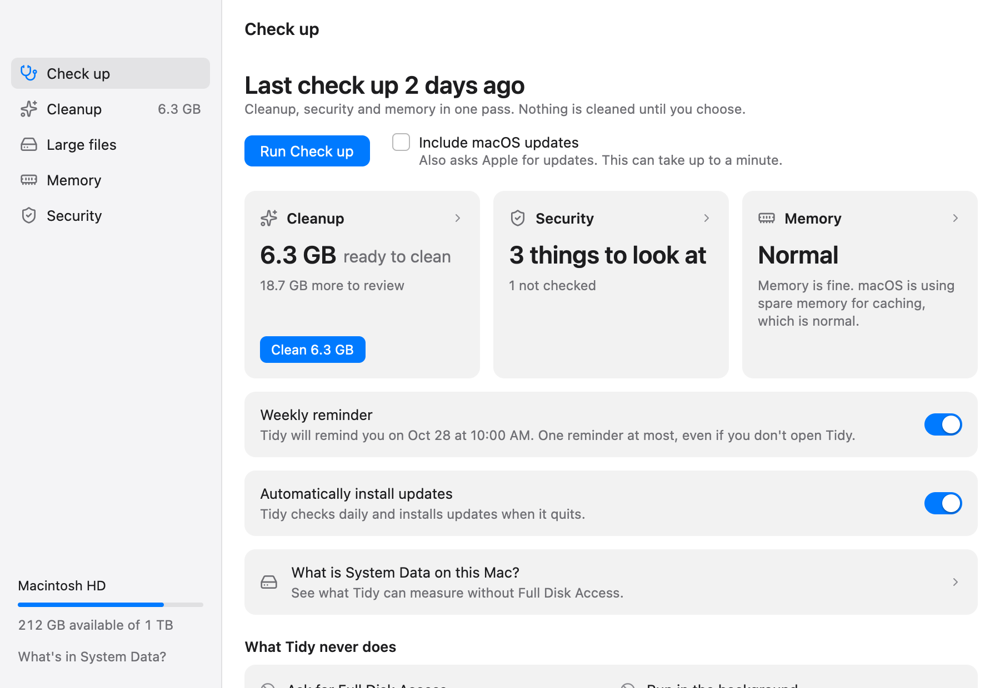

# Tidy

Tidy is a macOS utility that replaces CleanMyMac: it finds space you can get back, shows what uses your disk and memory, and runs a weekly security check.



## What it does

Six screens in the sidebar:

- Check up: one button runs the cleanup scan, the Security checks and a memory snapshot, and shows three cards that link to their screens. Holds the opt-in weekly reminder, the "What is System Data on this Mac?" sheet and the "What Tidy never does" list.
- Cleanup: space you can get back, in six groups (System and app caches, Logs, Developer, AI models and large app data, Old installers, Trash). Safe items are ticked, Review items are not. Details on each row says why it is offered, what rebuilds it, which checks guard the move and which rule matched. Old installers lists `.dmg` and `.pkg` files in Downloads older than 30 days, always unticked. A size map above the list draws each removable item as a tile sized by its space; ticked items are ink, and a click on a tile ticks it.
- Large files: the biggest files and folders, or the ones not opened lately, with Reveal and Move to Trash. Folders mode shows the open folder as a size map; a click on a folder tile opens it.
- Memory: a verdict from memory pressure, Pressure, Swap used and Compressed, a pressure graph, and the top apps by memory with Relaunch and a polite Quit. Chrome, Edge, Brave and Arc rows above 4 GB name the browser's own memory setting. This is the only screen that polls (every 2 seconds, only while visible).
- Security: FileVault, Firewall, Gatekeeper, System Integrity Protection, XProtect, macOS updates (on demand), login items and Chrome extensions, with New and Changed marks against your last check.
- Uninstaller: the apps in `/Applications` and `~/Applications` with their sizes, sorted by name, size or last opened (the ones you haven't opened come first). Open one to see the app and what it left in your Library (Application Support, Caches, Preferences, Containers and Group Containers, Saved Application State, Logs, HTTPStorages, WebKit data and launch agents), matched by bundle ID, helper IDs and signing team, each with its size. Uninstall shows a receipt first and moves everything to the Trash. Apple's apps and Tidy are never listed, an open app can't be uninstalled until it quits, and files in `/Library` are listed but left alone.

Other behavior:

- Items go to the Trash and nothing else. Before each move Tidy rereads the ignore list, checks that no process of yours holds a file open inside the path, and for build output checks for `*-keypair.json`, `.git` and Git-tracked files. A process list it cannot read skips every move.
- Relaunch sends a polite terminate, waits up to 10 seconds, then reopens the app without bringing it to the front. Quit sends a polite terminate; after 10 seconds the row says Still open and Force Quit appears behind a confirm. Tidy, Finder, WindowServer and loginwindow have no Quit button.
- System Data sheet: measures, read-only and only when opened, the parts Tidy can see without Full Disk Access. Docker and local Time Machine snapshots are report-only rows with commands to copy.
- `softwareupdate --list` runs only when you press Check now on Security or tick Include macOS updates on Check up.
- Weekly reminder: off by default, one notification at 10:00 local time, 7 days after the last check up, rescheduled after each check up and launch.
- Tidy > Check for Updates... asks the feed now. "Automatically install updates" (Check up screen, on by default) installs on quit.

### Keyboard

| Keys | Action |
|---|---|
| Cmd-1 to Cmd-6 | Check up, Cleanup, Large files, Memory, Security, Uninstaller |
| Cmd-R | Run the current screen again |
| Tab, Shift-Tab | Move through the sidebar, toolbar, rows (checkbox, Details, Reveal, more) and status bar |
| Space, Return | Press the focused control |
| Esc | Close a dialog, sheet or menu; focus returns to what opened it |

A focus ring shows only while the last input was a key press. Dialogs open with Cancel focused, so Return alone never confirms. Cmd-1 to Cmd-6 and Cmd-R work wherever focus is.

## Permissions and what it never does

- Documents, Desktop and Downloads: macOS asks once per folder, and only after a click (Scan Home Folder, or the first scan that needs a project root there). If you decline, Tidy skips the folder and says so.
- Notifications: asked only when you switch on the weekly reminder, never at launch.
- Never asks for Full Disk Access. Paths that need it are excluded up front.
- Never deletes outside the Trash. Emptying the Trash is a separate step you confirm, and Tidy deletes only what it moved there.
- Never runs in the background: nothing starts at login, no helper, no launch agent, no sudo.
- Never kills a process. Quit is a polite request; Force Quit needs a confirm.
- Never runs cleanup commands for you (`brew cleanup`, `pnpm store prune`, `simctl delete`, `purge`, `tmutil`, `docker`). It shows the command to copy. The one exception is read-only `tmutil listlocalsnapshots /`.
- Never shows alarms, badges, countdowns or upgrade copy. Cleanup and Large files scan only the home folder and have a hard denylist (Mail, Messages, Safari, Keychains, iCloud Drive, Photos library, `.ssh` and more).

## Install and updates

Build and install to `~/Applications`:

```sh
scripts/bundle.sh --release --install
```

Tidy updates itself with Sparkle from the public sdusteric/app-updates feed (`https://sdusteric.github.io/app-updates/tidy/appcast.xml`). The contract is `../app-updates/CONTRACT.md`. Install only when Tidy is not running.

# Developer

## Requirements

- macOS, Rust (edition 2024), the Xcode command line tools.
- `../app-updates` checked out next to this repo for `Sparkle.framework` 2.10.0, or `SPARKLE_FRAMEWORK` set. The build stops with a message when it is missing.
- An Apple Development signing identity for `scripts/bundle.sh`.

## Build and check

```sh
cargo build --workspace --all-targets
cargo fmt --all --check
cargo clippy --workspace --all-targets -- -D warnings
cargo test --workspace --exclude tidy-app
cargo test -p tidy-app -- --test-threads=1
cargo test -p tidy-core trash::      # one crate or a filter
scripts/accept.sh offline            # AC1 to AC10 and U1; a full run has FAIL 0 and SKIP 0
```

AC6 and AC7 read this Mac read-only (`sysctl`, `vm_stat`, `top`, `fdesetup`, `socketfilterfw`, `spctl`, `csrutil`, launch agent folders and signatures).

Scan a fake home, never the real one:

```sh
D=$(mktemp -d)
cargo run -p tidy-fixtures --bin tidy-fixture-home -- "$D"   # prints the TIDY_TEST_NOW value
TIDY_HOME="$D/tidy" TIDY_SCAN_ROOT="$D/home" TIDY_TEST_NOW=<printed> \
  TIDY_TEST_RUNNING=com.google.Chrome cargo run -p tidy-cli -- scan
```

`memory` and `security` only read. `checkup` writes `checkups.jsonl` and a Security file, so always set `TIDY_HOME`:

```sh
T=$(mktemp -d)
TIDY_HOME="$T" cargo run -p tidy-cli -- memory
TIDY_HOME="$T" cargo run -p tidy-cli -- security [--include-updates]   # updates refused under TIDY_HOME
```

| `tidyctl` command | Does |
|---|---|
| `scan` | Cleanup scan, prints the plan |
| `large [--min-mb N] [--not-opened] [--folders [REL_PATH]]` | Large files scan |
| `clean --safe` or `clean --ids ID,...` | Scan, then move items to the Trash (needs `TIDY_HOME` or `--real`) |
| `trash PATH...`, `empty-trash` | Move paths to the Trash, delete what Tidy moved there (same rule) |
| `history [--last N]` | Print history entries |
| `memory` | One memory snapshot |
| `security [--include-updates]` | Security checks, saved as `data/security/<id>.json` |
| `checkup [--include-updates]` | Scan, Security and memory; appends to `data/checkups.jsonl` |
| `explain ID` | Details of one item: reason, rebuild, checks, rule and pattern |
| `system-data` | What Tidy can measure of System Data |
| `apps` | The apps the Uninstaller lists |
| `leftovers APP` | An app (path or bundle ID) and what it left in the Library |
| `uninstall APP [--ids ...]` | Move an app and its ticked leftovers to the Trash (same rule as `clean`) |

Screenshots, light and dark, 1800 x 1240 px, without a window or a change of frontmost app:

```sh
scripts/shots-bundle.sh && SHOTS_RENDER=1 scripts/shots.sh checkup memory security cleanup large
```

They go to `docs/app-shots/<scenario>-<light|dark>.png`. `history` and `cleanup-focus` are two more scenarios.

## Layout

| Crate | Contents |
|---|---|
| `crates/tidy-core` | Library, no UI: model, command and event API, environment and test seams (`MemoryProbe`, `CommandRunner`, `OpenFilesProbe`), project guard, settings, history, instance lock, Trash guard, walker, memory engine, Security checks, check up log, reminder math, core actor |
| `crates/tidy-app` | GPUI app (library plus `tidy` binary): sidebar, six screens, History sheet, dialogs, `Terminator` and `Notifier` wrappers, demo scenarios |
| `crates/tidy-cli` | `tidyctl`, a headless driver that prints one JSON object per line |
| `crates/tidy-fixtures` | `tidy-fixture-home`: fake home folders with exact sizes and dates, fake Security output and process table |

Design doc (the contract): [docs/superpowers/specs/2026-10-23-tidy-design.md](docs/superpowers/specs/2026-10-23-tidy-design.md). It is a Rust and GPUI app on the same stack and look as Haul.

## Updates (Sparkle 2.10.0)

- `crates/tidy-app/build.rs` links the framework into the `tidy` binary only; `tidy-core` and `tidyctl` never link it. `bundle.sh` embeds it and signs inside out (`Installer.xpc`, `Downloader.xpc`, `Updater.app`, `Autoupdate`, framework, app). `codesign --verify --deep --strict` must pass.
- Info.plist has `SUFeedURL`, `SUPublicEDKey`, `SUEnableAutomaticChecks`, `SUAutomaticallyUpdate`, `SUScheduledCheckInterval` (86400). `CFBundleShortVersionString` is the `VERSION` file (keep equal to `Cargo.toml`); `CFBundleVersion` is the UTC build time.
- The updater starts once after launch (`crates/tidy-app/src/updates.rs`). It never starts with `TIDY_NO_UPDATES=1`, `TIDY_BACKGROUND`, `TIDY_DEMO`, `TIDY_DEMO_SHOT`, `SHOTS_RENDER`, `TIDY_HOME`, in unit tests or outside a bundle with `SUFeedURL`.
- `scripts/check-updates.sh <Tidy.app> <tidyctl>` checks a bundle against the contract (also AC U1). `scripts/release.sh [--notes notes.md] [--dry-run <dir>]` runs the offline acceptance, builds the bundle and calls `../app-updates/tools/publish.sh --app tidy`. Without `--dry-run` it publishes for real, so run it only with `--dry-run` unless releasing.

## Environment variables

| Variable | Effect |
|---|---|
| `TIDY_HOME=<dir>` | Moves every Tidy folder under `<dir>` (`data/`, `cache/`, `logs/`), swaps the macOS Trash for `<dir>/data/trash`, enables the test hooks |
| `TIDY_SCAN_ROOT`, `TIDY_TEST_RUNNING`, `TIDY_TEST_NOW`, `TIDY_TEST_COMMANDS`, `TIDY_TEST_MEMORY`, `TIDY_TEST_TZ` | Fake home, running apps, clock, Security outputs, process table, time zone. Only under `TIDY_HOME` |
| `TIDY_TEST_NO_SPOTLIGHT=1` | File times only for last-use dates (default under `TIDY_HOME`; `0` allows Spotlight) |
| `TIDY_BACKGROUND=1`, `TIDY_NO_UPDATES=1` | No activation or window; no Sparkle |
| `SPARKLE_FRAMEWORK`, `APP_UPDATES_PUBLISH` | Framework path; publish.sh used by `release.sh` |
| `TIDY_DEMO=<scenario>`, `TIDY_DEMO_SHOT=<png>`, `TIDY_DEMO_EXIT_SECS`, `TIDY_APPEARANCE` | Fixed UI for screenshots (no core, lock or disk access), offscreen PNG, self-quit (30), light or dark |
| `TIDY_LOG` | tracing filter for `tidyctl` (default `warn`) |

Without `TIDY_HOME`, test hooks are ignored and logged, and destructive `tidyctl` commands refuse to run (exit 5) unless you pass `--real`.

## Safety rules for tests and agents

- Always set `TIDY_HOME` to a temp dir and `TIDY_SCAN_ROOT` to a fake home inside it. Never scan, clean or measure the real home.
- Never use the macOS Trash (`SystemTrash` refuses under `TIDY_HOME`; its one real test needs `TIDY_TEST_REAL_TRASH=1`).
- Never show a window or take focus. Never quit or signal an app you did not start; tests use the fake `Terminator`.
- Never request notification permission (tests use the fake `Notifier`) and never let Sparkle start (`FakeUpdates`, `TIDY_NO_UPDATES=1`).
- Never run `softwareupdate`, `tmutil` or `docker` against this Mac. `SystemRunner` refuses them in tests and under `TIDY_HOME`; tests replay output through `TIDY_TEST_COMMANDS` or `ReplayRunner`.
- Security reads of the real Mac are read-only and limited to the status commands, the XProtect plist, launch agent and daemon folders, `launchctl print`, signature checks and a copy of Chrome's Secure Preferences.
